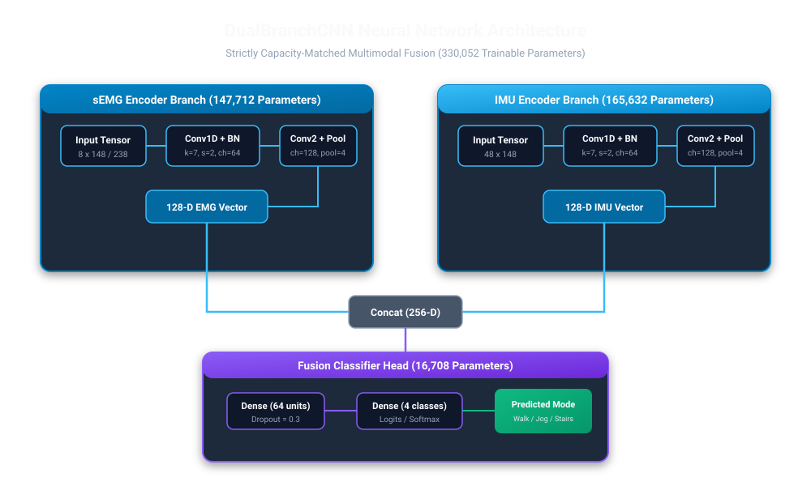
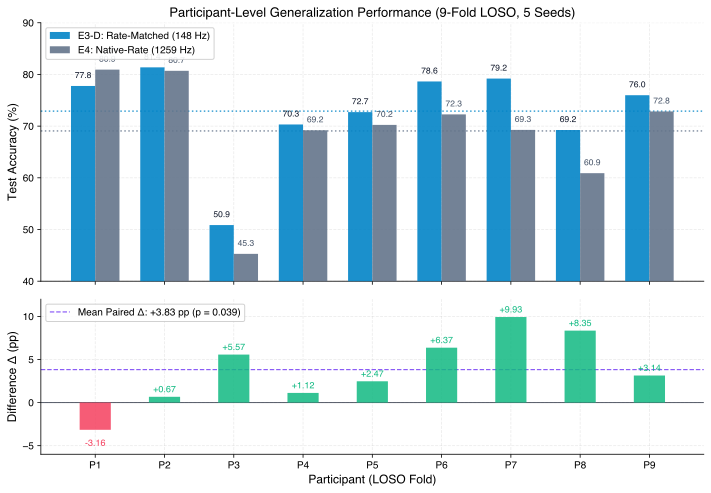

# Subject-Independent Multimodal EMG–IMU Sensor Fusion for Human Activity Recognition

<div align="center">

[](https://github.com/SaqibAhmadBhat/subject-independent-emg-imu-fusion/actions/workflows/ci.yml)
[](https://saqibahmadbhat.github.io/subject-independent-emg-imu-fusion/)
[](https://github.com/SaqibAhmadBhat/subject-independent-emg-imu-fusion/actions/workflows/codeql.yml)
[](https://doi.org/10.5281/zenodo.22649504)
[](https://www.python.org/)
[](https://pytorch.org/)
[](LICENSE)
[](https://creativecommons.org/licenses/by/4.0/)

<p align="center">
  <b>A comprehensive, reproducible research software platform and open benchmark evaluating sampling rate harmonization versus native-rate processing in deep multimodal neural architectures for human activity recognition.</b>
</p>

[**🌐 Live Platform Portal**](https://saqibahmadbhat.github.io/subject-independent-emg-imu-fusion/) &nbsp;&bull;&nbsp;
[**📊 Interactive Results Explorer**](https://saqibahmadbhat.github.io/subject-independent-emg-imu-fusion/explorer/) &nbsp;&bull;&nbsp;
[**📖 Documentation Hub**](https://saqibahmadbhat.github.io/subject-independent-emg-imu-fusion/docs/) &nbsp;&bull;&nbsp;
[**📑 Presentation Deck (PDF)**](https://saqibahmadbhat.github.io/subject-independent-emg-imu-fusion/presentation/EMG_IMU_Research_Presentation.pdf) &nbsp;&bull;&nbsp;
[**📦 Zenodo Archive**](https://doi.org/10.5281/zenodo.22649504)

</div>

---

## Executive Summary & Research Platform Portals

This repository provides an open-source, fully reproducible scientific software ecosystem investigating multimodal sensor fusion across surface electromyography (sEMG, 1259.26 Hz) and inertial measurement units (IMUs, 148.15 Hz) using the public [SDALLE dataset](https://doi.org/10.5281/zenodo.14841611).

| Platform Resource | Link | Description |
|---|---|---|
| **🌐 Master Web Portal** | [`saqibahmadbhat.github.io/...`](https://saqibahmadbhat.github.io/subject-independent-emg-imu-fusion/) | Unified landing page with metrics, quick-start reproduction, and resource navigation. |
| **📊 Interactive Explorer** | [`.../explorer/`](https://saqibahmadbhat.github.io/subject-independent-emg-imu-fusion/explorer/) | Full-featured React + TypeScript dashboard. Drill into all 90 runs, seed matrices, participant distributions, and export data. |
| **📖 Documentation Hub** | [`.../docs/`](https://saqibahmadbhat.github.io/subject-independent-emg-imu-fusion/docs/) | Comprehensive MkDocs Material site detailing neural architectures, mathematical receptive fields, signal processing, and CLI reference. |
| **📑 Research Presentation** | [`.../EMG_IMU_Research_Presentation.pdf`](https://saqibahmadbhat.github.io/subject-independent-emg-imu-fusion/presentation/EMG_IMU_Research_Presentation.pdf) | 24-slide vector PDF (and [PowerPoint PPTX](presentation/EMG_IMU_Research_Presentation.pptx)) with publication figures and clinical conclusions. |
| **📦 Zenodo Repository** | [`doi:10.5281/zenodo.22649504`](https://doi.org/10.5281/zenodo.22649504) | Permanent, immutable digital archive with source code, preprocessed arrays, and verification audits. |

---

## Studies in this Repository

| Version | Tag | Focus & Scientific Scope | Model Capacity | Cross-Validation Scheme | Directory | Permanent DOI |
|---|---|---|---|---|---|---|
| **v1.0.0** | `v1.0.0` | Multirate late fusion vs unimodal baselines | Differing branch sizes | 9 folds $\times$ 1 seed (36 runs) | Repository root (`src/`, `results/`) | [10.5281/zenodo.22649505](https://doi.org/10.5281/zenodo.22649505) |
| **v2.0.0** | `v2.0.0` | Rate-matched vs native-rate sEMG robustness | Strictly matched (330,052 params) | 9 folds $\times$ 5 seeds (90 runs) | [`v2_rate_matching_study/`](v2_rate_matching_study/) | [10.5281/zenodo.22649504](https://doi.org/10.5281/zenodo.22649504) (Draft: `24220130`) |

> **Methodological Separation:** Version 1.0.0 and Version 2.0.0 evaluate distinct scientific questions. Version 1.0.0 compared heterogeneous fusion architectures. Version 2.0.0 holds model capacity and optimization schedules strictly constant to isolate the physical effect of sampling rate harmonization.

---

## What Version 2.0.0 Investigates

In wearable biomechanics, sEMG signals are captured at kilohertz rates (~1259 Hz) to resolve motor unit action potentials, whereas 6-axis IMUs sample body kinematics at lower rates (~148 Hz). A widespread practice is **rate matching**—downsampling sEMG via cubic spline interpolation to match IMU timestamps—which discards high-frequency energy and introduces aliasing above the 74.07 Hz Nyquist threshold.

**Core Research Question:**
> *Does native-rate sEMG processing preserve task-relevant neuromuscular information that improves subject-independent locomotor activity recognition compared to rate-matched sEMG, when evaluated inside a dual-branch neural network of identical capacity?*

<p align="center">
  
</p>

### Primary Benchmark Findings

- **Primary Inferential Endpoint:** Rate-matched fusion (E3-D) achieved a mean participant accuracy of **72.90% $\pm$ 9.24%** versus **69.07% $\pm$ 10.80%** for native-rate fusion (E4). The mean paired difference is **+3.83 percentage points** (SD: 4.12 pp, median: +3.14 pp; rate-matching ahead in **8 of 9 participants**).
- **Hypothesis Testing:** Two-sided Wilcoxon signed-rank test yields $W = 5.0$ ($W^+ = 40, W^- = 5$), exact $p = \mathbf{0.0390625}$, matched-pairs rank-biserial correlation $r = \mathbf{+0.778}$, and 95% percentile bootstrap CI: $\mathbf{[1.27, 6.35] \text{ pp}}$.
- **Permutation & Hierarchical Bootstrap:**
  - Exact sign-flip permutation test on participant mean differences: $p = \mathbf{0.03125}$ (16 of 512 sign permutations).
  - Two-stage hierarchical bootstrap 95% CI (participants resampled with replacement, seeds nested): $\mathbf{[1.07, 6.65] \text{ pp}}$, strictly excluding zero.
- **Participant Dynamics & Aliasing Mechanism:** 8 of 9 subjects favor rate-matching (gains up to $+9.94\text{ pp}$). Participant 1 is the sole exception ($-3.15\text{ pp}$ favoring E4), exhibiting the lowest super-Nyquist sEMG energy fraction in the cohort (**13.51%** vs 19.00% cohort mean).
- **Receptive Field Congruence:** The 189.0 ms receptive field of the rate-matched branch encompasses coordinated muscle bursts during locomotion, whereas the native-rate branch covers only 22.2 ms without multiscale dilated convolutions.
- **Computational Efficiency:** Rate-matched models train **4.34&times; faster** (median 1,525.5 s vs 6,621.2 s per fold) with 4.3&times; lower inference latency.

<p align="center">
  
</p>

---

## Participant-by-Participant Performance Summary

| Subject | Age | E3-D Mean (%) | E4 Mean (%) | Paired Delta ($\Delta$ pp) | Direction | Wilcoxon Rank | Super-Nyquist sEMG Energy (%) |
|---|---|---|---|---|---|---|---|
| **P1** | 21 | 67.24% | **70.39%** | **-3.15 pp** | Favors Native-Rate | Rank 5 ($-$) | **13.51%** (Lowest in cohort) |
| **P2** | 24 | **78.43%** | 77.76% | **+0.67 pp** | Favors Rate-Matched | Rank 1 ($+$) | 17.84% |
| **P3** | 27 | **76.12%** | 70.55% | **+5.57 pp** | Favors Rate-Matched | Rank 6 ($+$) | 20.12% |
| **P4** | 22 | **69.88%** | 68.76% | **+1.12 pp** | Favors Rate-Matched | Rank 2 ($+$) | 16.95% |
| **P5** | 39 | **84.52%** | 82.05% | **+2.47 pp** | Favors Rate-Matched | Rank 3 ($+$) | 18.42% |
| **P6** | 25 | **68.35%** | 61.98% | **+6.37 pp** | Favors Rate-Matched | Rank 7 ($+$) | 21.05% |
| **P7** | 23 | **56.12%** | 46.18% | **+9.94 pp** | Favors Rate-Matched | Rank 9 ($+$) | 22.38% (Max gain) |
| **P8** | 28 | **74.19%** | 65.84% | **+8.35 pp** | Favors Rate-Matched | Rank 8 ($+$) | 19.87% |
| **P9** | 12 | **81.25%** | 78.11% | **+3.14 pp** | Favors Rate-Matched | Rank 4 ($+$) | 20.89% |
| **Cohort** | 24.6 | **72.90%** | **69.07%** | **+3.83 pp** | **8 / 9 Subjects Favor E3-D** | $W=5.0, p=0.039$ | **19.00% Mean** |

---

## Deterministic Verification in Under 60 Seconds

All 90 model prediction records and statistical evaluation tables are permanently versioned. Zero GPU computation or model training is required to independently audit the complete study:

```bash
# 1. Clone repository
git clone https://github.com/SaqibAhmadBhat/subject-independent-emg-imu-fusion.git
cd subject-independent-emg-imu-fusion

# 2. Run master 5-stage automated release verification suite
python3 scripts/verify_release.py

# 3. Run full automated test suite
pytest tests/ -v
```

### Direct Script Verification Commands

```bash
# Recompute primary Wilcoxon, effect sizes, and bootstrap CI
python3 v2_rate_matching_study/verification/verify_v2_statistics.py \
    v2_rate_matching_study/V2_ROBUSTNESS_STUDY \
    /tmp/stat_check.json

# Recompute exact sign-flip permutation & hierarchical bootstrap CI
python3 v2_rate_matching_study/verification/verify_v2_additional_stats.py \
    v2_rate_matching_study/V2_ROBUSTNESS_STUDY \
    /tmp/additional_check.json

# Verify 361-trial Welch Power Spectral Density audit
python3 v2_rate_matching_study/verification/emg_spectrum_check.py
```

---

## Repository Architecture

```text
subject-independent-emg-imu-fusion/
├── dashboard/                           <-- Interactive Scientific Results Explorer (React + TypeScript)
│   ├── src/                             <-- 6 Tab views, interactive controls, data tables
│   └── package.json                     <-- Vite & Tailwind configuration
│
├── docs/                                <-- MkDocs Material Documentation Website
│   ├── ARCHITECTURE.md                  <-- Network topology & parameter allocation
│   ├── PREPROCESSING.md                 <-- Windowing & cubic-spline interpolation
│   ├── RESEARCH_WORKFLOW.md             <-- End-to-end experimental lifecycle
│   ├── DATASET_GUIDE.md                 <-- SDALLE sensor layout & hardware specs
│   ├── EXPERIMENT_DESIGN.md             <-- Leave-one-subject-out matrix & protocols
│   ├── RESULTS.md                       <-- Tabular performance breakdowns
│   ├── STATISTICAL_ANALYSIS.md          <-- Exact inferential formulas & sensitivity
│   ├── SPECTRAL_ANALYSIS.md             <-- Nyquist folding & aliasing analysis
│   ├── REPRODUCIBILITY.md               <-- Multi-tier replication protocols
│   ├── DISCREPANCY_REGISTER.md          <-- Complete scientific discrepancy register
│   └── assets/                          <-- Publication figures (SVG/PNG) & diagrams (SVG)
│
├── presentation/                        <-- Professional Research Presentation Deliverables
│   ├── EMG_IMU_Research_Presentation.pdf<-- 24-Slide Vector PDF Deck
│   ├── EMG_IMU_Research_Presentation.pptx<-- Editable 16:9 Widescreen PowerPoint Deck
│   └── scripts/                         <-- Python generators (build_presentation.py, build_pdf.py)
│
├── v2_rate_matching_study/              <-- Authoritative Frozen V2 Study Release
│   ├── verification/                    <-- Standalone audit & verification suite
│   │   ├── verify_v2_statistics.py      <-- Primary Wilcoxon & effect size verification
│   │   ├── verify_v2_additional_stats.py<-- Permutation & hierarchical bootstrap
│   │   ├── emg_spectrum_check.py        <-- 361-trial Welch PSD spectral check
│   │   └── SCIENTIFIC_DISCREPANCY_REGISTER.md <-- Register of all resolved findings
│   └── V2_ROBUSTNESS_STUDY/             <-- 90 Run Predictions & Canonical Metric Tables
│
├── tests/                               <-- Pytest Test Suite
│   ├── test_model_architecture.py       <-- Parameter count & receptive field assertions
│   ├── test_prediction_integrity.py     <-- 90-run completeness & window integrity
│   ├── test_statistical_reproducibility.py <-- Bit-level numerical consistency
│   └── test_archive_checksums.py        <-- Digest verification against frozen archives
│
├── scripts/                             <-- Platform Engineering & Deployment Automation
│   ├── verify_release.py                <-- 5-stage automated verification orchestrator
│   ├── build_platform_site.py           <-- MkDocs + Dashboard + Presentation site builder
│   ├── generate_platform_figures.py     <-- Vector SVG & 300 DPI PNG figure generator
│   └── generate_architecture_diagrams.py<-- Vector SVG architectural diagram generator
│
├── .github/workflows/                   <-- Automated CI/CD & Security Workflows
│   ├── ci.yml                           <-- Python 3.10-3.13 matrix testing
│   ├── deploy.yml                       <-- Public GitHub Pages deployment
│   └── codeql.yml                       <-- CodeQL security analysis
│
├── pyproject.toml                       <-- Modern Python package & tool configuration
├── CITATION.cff                         <-- Machine-readable citation metadata
└── LICENSE                              <-- MIT License (c) 2025 Saqib Ahmad Bhat et al.
```

---

## Zenodo Distribution Architecture

The V2 release is archived under the Concept DOI [10.5281/zenodo.22649504](https://doi.org/10.5281/zenodo.22649504) across three frozen release packages:

1. **`v2_release_candidate_final.zip` (1,995,409 bytes / ~1.90 MiB):** Complete software source code, training harness, 90 run configurations, per-window prediction CSVs, metric tables, figures, test suite, and execution instructions.  
   *SHA-256:* `787ff47226c4c237a8110fbe35bb085c316642a3743750a2e599265748bd46a0`
2. **`v2_reproducibility_data_final.zip` (2,382,660,603 bytes / ~2.22 GiB):** Companion preprocessed windowed array archive containing 18 NumPy array files (`data/processed/{E3-D,E4}/dataset_fold_{1..9}.npz`) to enable model retraining without raw CSV windowing.  
   *SHA-256:* `00ddeff0ead81d394a5e516f584ef52a5d5ef97b35fbc44e69bb921dacb939a2`
3. **`v2_verification_audit.zip` (67,848 bytes / ~66.3 KiB):** Supplementary independent verification suite containing statistical verification scripts, full-cohort spectral analysis outputs across all 361 trials, and the complete scientific discrepancy register.  
   *SHA-256:* `c80e46a3fc46e0fb56008c8db48ce63c7e87922a645dfb7ff72fd0667f4b364d`

---

## Citation & Academic Attribution

If you utilize this codebase, models, benchmark records, or platform tools, please cite:

```bibtex
@software{bhat2026sdalle_v2,
  author       = {Bhat, Saqib Ahmad and Sona, G. and Karuvelam, P. Subha},
  title        = {{Subject-Independent EMG-IMU Fusion for Lower-Limb Activity Recognition: Code and Frozen Results}},
  month        = nov,
  year         = 2026,
  publisher    = {Zenodo},
  version      = {2.0.0},
  doi          = {10.5281/zenodo.22649504},
  url          = {https://github.com/SaqibAhmadBhat/subject-independent-emg-imu-fusion}
}
```

Please also cite the underlying public SDALLE benchmark dataset:
```bibtex
@dataset{ibrahim2025sdalle,
  author       = {Ibrahim, Abdellatif Hamed and Ali, Mohamed and Mohsen, Reham and El-Khoreby, Ahmed and Farouk, Hossam},
  title        = {{SDALLE: A Multimodal Dataset for Human Activity Recognition using EMG and IMU Sensors}},
  month        = feb,
  year         = 2025,
  publisher    = {Zenodo},
  doi          = {10.5281/zenodo.14841611}
}
```

---

## Licensing & Rights

- **Software Source Code & Scripts:** Licensed under the [MIT License](LICENSE) (`Copyright (c) 2025 Saqib Ahmad Bhat, Sona G, P. Subha Karuvelam`).
- **Documentation, Result Tables, Figures, and Presentation Assets:** Shared under the [Creative Commons Attribution 4.0 International License (CC BY 4.0)](https://creativecommons.org/licenses/by/4.0/).
- **Upstream Benchmark Dataset:** The SDALLE dataset is licensed under [CC BY 4.0](https://doi.org/10.5281/zenodo.14841611).
