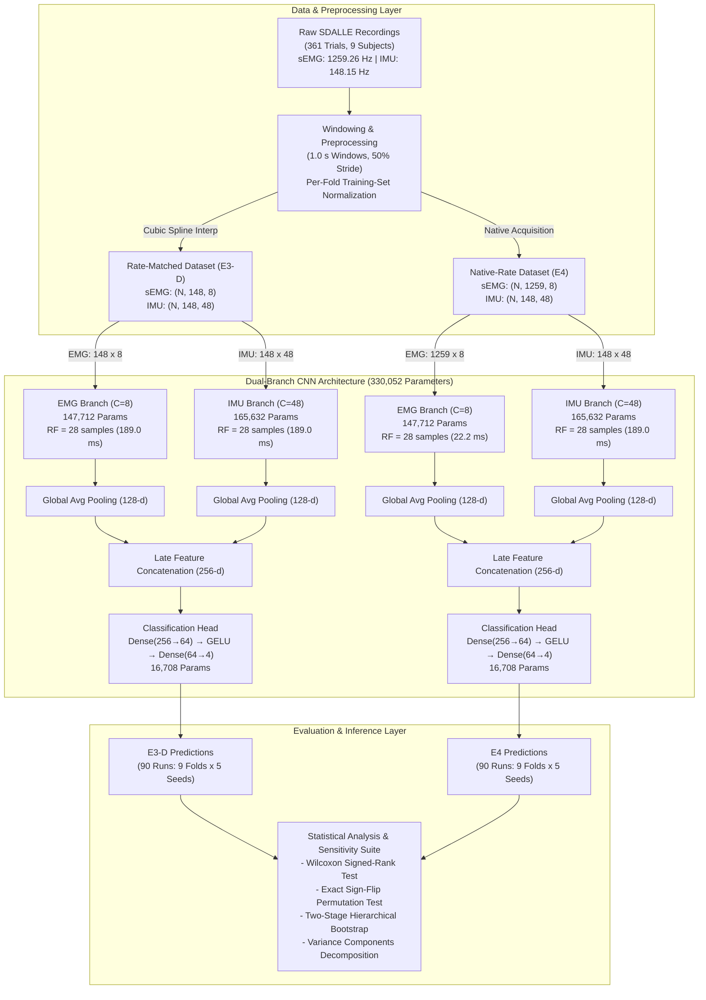

# Software Architecture — Multimodal EMG–IMU Robustness Study (V2)

## 1. High-Level System Architecture

The V2 research software evaluates the impact of sampling rate harmonization versus native-rate processing in deep multimodal sensor fusion for subject-independent human activity recognition (HAR).

---

## 2. Neural Network Branch Specification

Both branches in the dual-branch convolutional neural network (`DualBranchCNN` in `src/models.py`) share an identical block structure:

```mermaid
graph LR
    IN["Input (B, L, C)"] --> TR["Transpose (B, C, L)"]
    TR --> C1["Conv1D (k=7, s=1, out=64)<br/>No Bias"]
    C1 --> BN1["BatchNorm1d(64)"]
    BN1 --> A1["GELU"]
    A1 --> C2["Conv1D (k=5, s=1, out=64)<br/>No Bias"]
    C2 --> BN2["BatchNorm1d(64)"]
    BN2 --> A2["GELU"]
    A2 --> MP["MaxPool1D (k=2, s=2)"]
    MP --> C3["Conv1D (k=5, s=1, out=128)<br/>No Bias"]
    C3 --> BN3["BatchNorm1d(128)"]
    BN3 --> A3["GELU"]
    A3 --> C4["Conv1D (k=5, s=1, out=128)<br/>No Bias"]
    C4 --> BN4["BatchNorm1d(128)"]
    BN4 --> A4["GELU"]
    A4 --> GAP["AdaptiveAvgPool1d(1)"]
    GAP --> FL["Flatten (128-d)"]
```

### Parameter Count Breakdown
Convolutions are computed without bias terms (`bias=False`), followed by batch normalization and GELU activations:

1. **EMG Branch ($C = 8$ channels):**
   - $\text{Conv1}: 7 \times 8 \times 64 = 3{,}584$
   - $\text{BatchNorm1}: 2 \times 64 = 128$
   - $\text{Conv2}: 5 \times 64 \times 64 = 20{,}480$
   - $\text{BatchNorm2}: 2 \times 64 = 128$
   - $\text{Conv3}: 5 \times 64 \times 128 = 40{,}960$
   - $\text{BatchNorm3}: 2 \times 128 = 256$
   - $\text{Conv4}: 5 \times 128 \times 128 = 81{,}920$
   - $\text{BatchNorm4}: 2 \times 128 = 256$
   - **Total EMG Branch Parameters:** $\mathbf{147{,}712}$

2. **IMU Branch ($C = 48$ channels):**
   - $\text{Conv1}: 7 \times 48 \times 64 = 21{,}504$
   - $\text{BatchNorm1}: 2 \times 64 = 128$
   - $\text{Conv2}: 5 \times 64 \times 64 = 20{,}480$
   - $\text{BatchNorm2}: 2 \times 64 = 128$
   - $\text{Conv3}: 5 \times 64 \times 128 = 40{,}960$
   - $\text{BatchNorm3}: 2 \times 128 = 256$
   - $\text{Conv4}: 5 \times 128 \times 128 = 81{,}920$
   - $\text{BatchNorm4}: 2 \times 128 = 256$
   - **Total IMU Branch Parameters:** $\mathbf{165{,}632}$

3. **Classification Head:**
   - $\text{Linear1}: 256 \times 64 + 64 = 16{,}448$
   - $\text{Linear2}: 64 \times 4 + 4 = 260$
   - **Total Classification Head Parameters:** $\mathbf{16{,}708}$

**Overall Network Capacity:** $147{,}712 + 165{,}632 + 16{,}708 = \mathbf{330{,}052 \text{ parameters}}$.

The exact parameter count is identical between the rate-matched (E3-D) and native-rate (E4) networks, ensuring that performance differences cannot be attributed to model capacity.

---

## 3. Receptive Field Derivation

The theoretical receptive field (RF) and stride (jump $j$) at each layer of the feature extractor:

| Layer | Kernel ($k$) | Stride ($s$) | Jump in ($j_{\text{in}}$) | Receptive Field ($RF$) | Temporal Span (Native Rate, $1259.26$ Hz) | Temporal Span (Rate-Matched, $148.15$ Hz) |
|---|---|---|---|---|---|---|
| **Input** | — | — | 1 | 1 sample | 0.79 ms | 6.75 ms |
| **Conv1** | 7 | 1 | 1 | $1 + (7-1)\times 1 = \mathbf{7}$ | 5.56 ms | 47.25 ms |
| **Conv2** | 5 | 1 | 1 | $7 + (5-1)\times 1 = \mathbf{11}$ | 8.74 ms | 74.25 ms |
| **MaxPool** | 2 | 2 | 1 | $11 + (2-1)\times 1 = \mathbf{12}$ | 9.53 ms | 81.00 ms |
| **Conv3** | 5 | 1 | 2 | $12 + (5-1)\times 2 = \mathbf{20}$ | 15.88 ms | 135.00 ms |
| **Conv4 (Final)** | 5 | 1 | 2 | $20 + (5-1)\times 2 = \mathbf{28}$ | $\mathbf{22.24 \text{ ms}}$ | $\mathbf{189.00 \text{ ms}}$ |

Following the final convolution, **Adaptive Average Pooling (`AdaptiveAvgPool1d(1)`)** spans the entire temporal sequence ($148$ samples for E3-D, $1259$ samples for E4), integrating features across the entire $1.0\text{ s}$ window before classification.
