# Reproducibility Framework & Verification Guide

This study implements a three-tier reproducibility framework designed for independent scientific verification, peer review, and full pipeline execution.

---

## 1. Three-Tier Reproducibility Architecture

```mermaid
graph TD
    subgraph Tier1 ["Tier 1: Stored Prediction Verification (Instant: < 10 s)"]
        T1_IN["90 Run Records (predictions.csv, meta.json, history.json)"]
        T1_SCR["verify_v2_statistics.py & verify_v2_additional_stats.py"]
        T1_OUT["Reproduces exact Manuscript Tables 2–4, Wilcoxon p=0.039, Permutation p=0.031, Bootstrap CIs"]
        T1_IN --> T1_SCR --> T1_OUT
    end

    subgraph Tier2 ["Tier 2: Model Retraining from Processed Arrays (~4–8 GPU hrs / ~36 CPU hrs)"]
        T2_IN["18 Preprocessed .npz Arrays (v2_reproducibility_data_final.zip)"]
        T2_SCR["robustness_train.py (DualBranchCNN, 5 Seeds x 9 Folds)"]
        T2_OUT["Reproduces trained models, prediction CSVs, and general accuracy gap within seed noise"]
        T2_IN --> T2_SCR --> T2_OUT
    end

    subgraph Tier3 ["Tier 3: Raw Signal Preprocessing (~15 mins)"]
        T3_IN["Raw SDALLE Benchmark CSVs (DOI: 10.5281/zenodo.14841611)"]
        T3_SCR["build_datasets_v2.py & windower_v2.py (Cubic Spline Interp)"]
        T3_OUT["Regenerates the 18 .npz input arrays bit-identically"]
        T3_IN --> T3_SCR --> T3_OUT
    end
```



---

## 2. Tier 1: Verifying Stored Predictions (< 10 Seconds)

Tier 1 allows reviewers and independent researchers to reproduce every single table, metric, confidence interval, and hypothesis test reported in Manuscript v2.1 directly from the frozen per-window prediction CSVs. No GPU, model checkpoints, or training time are required.

### Execution Command
```bash
# Navigate to the repository root
cd subject-independent-emg-imu-fusion

# Run the primary statistical verification
python3 v2_rate_matching_study/verification/verify_v2_statistics.py \
    v2_rate_matching_study/V2_ROBUSTNESS_STUDY \
    /tmp/stat_check.json

# Run the sensitivity & post hoc analysis suite
python3 v2_rate_matching_study/verification/verify_v2_additional_stats.py \
    v2_rate_matching_study/V2_ROBUSTNESS_STUDY \
    /tmp/additional_check.json
```

### Expected Output Summary
```text
Mean paired difference (RM - NR): +3.8303 pp
Exact two-sided Wilcoxon signed-rank test: W = 5, p = 0.0390625
Matched-pairs rank-biserial correlation: r = 0.7778
Percentile bootstrap 95% CI: [1.2713, 6.3548] pp
Exact sign-flip permutation test: p = 0.03125 (16 / 512)
Two-stage hierarchical bootstrap 95% CI: [1.0671, 6.6489] pp
Leave-one-seed-out p-value range: 0.0117 to 0.0547 (Rate matching ahead in 8/9 participants)
Seed-level within-participant SD: 4.2321 pp
Between-participant SD: 3.6569 pp (ICC = 0.4275)
```

---

## 3. Tier 2: Model Retraining from Arrays

Tier 2 trains the dual-branch convolutional neural network from the preprocessed NumPy array files across all 9 folds and 5 random seeds.

### Prerequisites
1. Download `v2_reproducibility_data_final.zip` (2.22 GB) from Zenodo Record `10.5281/zenodo.24220130`.
2. Extract the archive into `v2_rate_matching_study/data/processed/`:
   ```bash
   unzip v2_reproducibility_data_final.zip -d v2_rate_matching_study/
   ```
   Confirm presence of:
   - `v2_rate_matching_study/data/processed/E3-D/dataset_fold_{1..9}.npz`
   - `v2_rate_matching_study/data/processed/E4/dataset_fold_{1..9}.npz`

### Retraining Execution
```bash
# Retrain a single fold (e.g., Seed 42, Fold 1, Condition E3-D)
python3 v2_rate_matching_study/V2_ROBUSTNESS_STUDY/robustness_train.py \
    --seed 42 \
    --condition E3-D \
    --fold 1 \
    --epochs 50 \
    --device cpu

# Retrain the full study (all 90 runs; execute via background harness)
bash v2_rate_matching_study/V2_ROBUSTNESS_STUDY/run_study.sh
```

---

## 4. Tier 3: Preprocessing from Raw SDALLE Data

Tier 3 regenerates the 18 preprocessed `.npz` dataset files directly from raw continuous SDALLE CSV recordings.

### Prerequisites
1. Download raw SDALLE files from Zenodo: `https://doi.org/10.5281/zenodo.14841611`.
2. Extract to a local directory: e.g., `/path/to/SDALLE/`.
3. Run the array generation check:
   ```bash
   python3 v2_rate_matching_study/verification/regenerate_arrays_check.py \
       /path/to/SDALLE \
       v2_rate_matching_study/data/processed \
       /tmp/regen_report.json
   ```
   The script verifies that newly generated `.npz` files match the content digests of the canonical arrays.

---

## 5. Environment & Platform Dependencies

- **OS Tested:** macOS (Darwin arm64, Apple Silicon M-series) and Linux (Ubuntu 22.04 LTS x86_64).
- **Python Version:** 3.10, 3.11, 3.12, 3.13.
- **Key Packages:**
  - `torch >= 2.0.0`
  - `numpy >= 1.24.0, < 3.0.0`
  - `scipy >= 1.10.0`
  - `pandas >= 2.0.0`

### Sources of Numerical Variation
- **Prediction-Level Invariance:** The stored prediction CSVs in `v2_rate_matching_study/V2_ROBUSTNESS_STUDY/seed_*/` are static, bit-identical records; Tier 1 recomputation is 100% deterministic across all platforms.
- **Training Non-Determinism:** Cross-platform floating-point arithmetic (e.g. CUDA cuDNN non-deterministic convolution algorithms vs. CPU linear algebra) introduces minor run-to-run weight variations during retraining. As shown in our variance decomposition, seed-level variations are on the order of $\pm 4.23$ pp, while the aggregated 5-seed cohort advantage (+3.83 pp) remains consistent.
