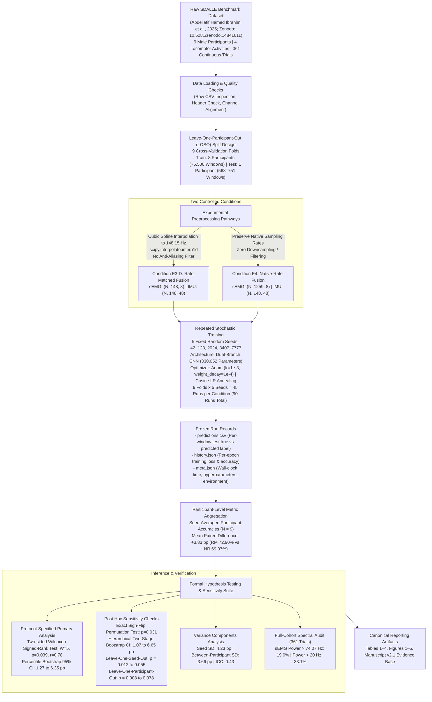

# Research Workflow & Experiment Lifecycle

This document describes the end-to-end scientific methodology and experimental lifecycle implemented in the V2 study.

---

## 1. End-to-End Experiment Lifecycle

---

## 2. Experimental Conditions: E3-D versus E4

| Feature / Dimension | Condition E3-D (Rate-Matched Fusion) | Condition E4 (Native-Rate Fusion) | Scientific Significance |
|---|---|---|---|
| **sEMG Sampling Frequency** | **148.15 Hz** (nominal downsampling) | **1259.26 Hz** (unaltered native rate) | Investigates whether sEMG downsampling impairs classification. |
| **IMU Sampling Frequency** | **148.15 Hz** (native rate) | **148.15 Hz** (native rate) | IMU kinematics are identical across conditions. |
| **Interpolation Method** | Cubic spline (`scipy.interpolate.interp1d(kind='cubic')`) evaluated at IMU timepoints | None (native time series) | Standard rate-matching practice without anti-aliasing pre-filtering. |
| **Input Sequence Length** | sEMG: **148** samples IMU: **148** samples | sEMG: **1259** samples IMU: **148** samples | Rate matching reduces sEMG sequence length by an 8.5× factor. |
| **Model Architecture** | `DualBranchCNN` (330,052 parameters) | `DualBranchCNN` (330,052 parameters) | **Identical capacity and structure** between conditions. |
| **EMG Branch Receptive Field** | 28 samples = **189.00 ms** | 28 samples = **22.24 ms** | Convolutions at native rate span a much narrower temporal interval. |
| **Global Pooling** | Spans full 148 samples (1.0 s) | Spans full 1259 samples (1.0 s) | Both models aggregate across the entire 1.0 s window via GAP. |
| **Median Training Time** | **1,525.5 s** per run | **6,621.2 s** per run (**4.34× longer**) | Native-rate convolution on 1259 samples incurs substantial overhead. |
| **Observed Accuracy (Mean)** | **72.90%** $\pm$ 9.24% | **69.07%** $\pm$ 10.80% | Paired difference: **+3.83 pp** favoring rate matching. |

---

## 3. Methodological Principles

### A. Non-Contaminated Normalization
All input normalizations (channel-wise z-score) are fitted **strictly on the training partition of each fold**:
$$\mu_{\text{train}} = \frac{1}{N_{\text{train}} L} \sum_{i, t} x_{i, t}, \quad \sigma_{\text{train}} = \sqrt{\frac{1}{N_{\text{train}} L} \sum_{i, t} (x_{i, t} - \mu_{\text{train}})^2}$$
Test data are standardized using $\mu_{\text{train}}$ and $\sigma_{\text{train}}$. No test fold information leaks into training data or normalization.

### B. Unit of Inferential Analysis
The participant ($N=9$) is the unit of statistical inference. Windows within a participant are correlated (overlapping by 50% across consecutive samples). Therefore, all hypothesis tests and confidence intervals are computed over participant-level summary metrics, not on pooled individual windows.

### C. Accounting for Stochastic Training Variability
Prior studies often evaluate a single seed, risking seed-dependent bias. In V2, 5 random seeds (42, 123, 2024, 3407, 7777) are executed across all 9 folds, yielding 45 runs per condition. Our variance decomposition reveals that seed-to-seed standard deviation within participants ($4.23$ pp) exceeds between-participant standard deviation ($3.66$ pp), demonstrating that multi-seed replication is essential for robust deep learning evaluation in wearable HAR.
