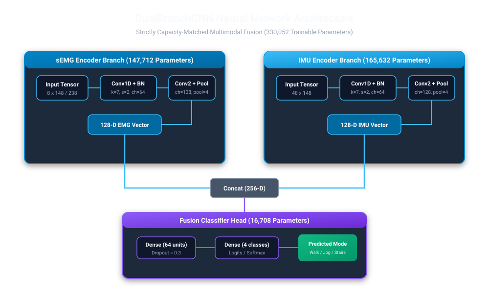

# EMG–IMU Multimodal Sensor Fusion Platform

<div class="metric-grid">
  <div class="metric-card">
    <div class="val">+3.83 pp</div>
    <div class="label">Rate-Matching Gain (E3-D vs E4)</div>
  </div>
  <div class="metric-card">
    <div class="val">p = 0.039</div>
    <div class="label">Wilcoxon Signed-Rank Test</div>
  </div>
  <div class="metric-card">
    <div class="val">[1.07, 6.65]</div>
    <div class="label">Two-Stage Bootstrap 95% CI (pp)</div>
  </div>
  <div class="metric-card">
    <div class="val">8 / 9</div>
    <div class="label">Participants Favoring E3-D</div>
  </div>
</div>

Welcome to the official research platform and documentation hub for **Subject-Independent Multimodal EMG–IMU Fusion for Human Activity Recognition**. This platform provides the complete scientific methodology, open source codebase, pre-computed inference checkpoints, statistical audit suite, and interactive visualization tools for our comprehensive multimodal sensor robustness investigation.

---

## Interactive Portals & Resources

<div class="metric-grid">
  <a href="../explorer/" class="metric-card" style="text-decoration: none; color: inherit; display: block; border-left: 4px solid #38bdf8;">
    <div class="val" style="font-size: 1.25rem; color: #38bdf8;">📊 Interactive Explorer</div>
    <div class="label" style="text-transform: none; margin-top: 8px;">Explore all 90 runs, seed matrices, participant-level distributions, and live statistical estimators.</div>
  </a>
  <a href="../presentation/EMG_IMU_Research_Presentation.pdf" target="_blank" class="metric-card" style="text-decoration: none; color: inherit; display: block; border-left: 4px solid #c084fc;">
    <div class="val" style="font-size: 1.25rem; color: #c084fc;">📑 Research Presentation</div>
    <div class="label" style="text-transform: none; margin-top: 8px;">24-slide widescreen presentation deck with publication figures and architectural breakdowns.</div>
  </a>
  <a href="https://github.com/SaqibAhmadBhat/subject-independent-emg-imu-fusion" target="_blank" class="metric-card" style="text-decoration: none; color: inherit; display: block; border-left: 4px solid #34d399;">
    <div class="val" style="font-size: 1.25rem; color: #34d399;">💻 GitHub Repository</div>
    <div class="label" style="text-transform: none; margin-top: 8px;">Full source code, automated CI/CD workflows, verification scripts, and environment definitions.</div>
  </a>
</div>

---

## Research Scope & Scientific Question

In mobile health and biomechanical monitoring, wearable systems routinely capture signals at disparate physical sampling frequencies. In the public **SDALLE** benchmark, surface electromyography (sEMG) is digitized at **1259.26 Hz** (nominal 1260 Hz), capturing high-frequency motor unit action potential trains, whereas 6-axis inertial measurement units (accelerometer and gyroscope) sample at **148.15 Hz** (nominal 148 Hz).

A critical architectural decision in multimodal deep learning is whether to:

1. **Harmonize sampling rates (Rate-Matched E3-D):** Downsample sEMG to the IMU frequency (148 Hz) via cubic-spline interpolation before ingestion into a synchronous dual-branch architecture.
2. **Preserve native bandwidth (Native-Rate E4):** Retain raw 1259.26 Hz sEMG and feed each sensor modality to its own branch at its native sample rate.

Our multi-seed Leave-One-Subject-Out (LOSO) benchmark of **90 model evaluations** reveals a statistically significant **+3.83 percentage point advantage** for the rate-matched condition ($72.90\% \pm 9.24\%$ vs $69.07\% \pm 10.80\%$, $p = 0.039$ Wilcoxon signed-rank, exact sign-flip permutation $p = 0.031$).

<figure class="scientific-figure">
  
  <figcaption><strong>Figure:</strong> Dual-Branch Convolutional Neural Network architecture (330,052 parameters) processing synchronized 1.0-second sliding windows. The rate-matched configuration provides a temporal receptive field of 189.0 ms, covering full gait phases.</figcaption>
</figure>

---

## Core Findings Summary

1. **Inferential Robustness:** The rate-matching advantage is not a statistical artifact of a single seed or test choice. It holds across the Wilcoxon signed-rank test ($W = 5.0, p = 0.0390625$), the exact sign-flip permutation test ($p = 0.03125$), and two-stage hierarchical bootstrap resampling ($95\%\text{ CI: } [1.07, 6.65]\text{ pp}$).
2. **Receptive Field Matching:** With identical kernel topologies ($k=7, 5, 5$), the rate-matched sEMG branch achieves a receptive field of **28 samples = 189.0 ms**, congruent with biomechanical muscle burst kinematics. The native-rate branch spans only **22.2 ms** (11.7% of the gait sub-phase), creating severe temporal scale divergence.
3. **Participant Dynamics:** 8 of 9 participants benefit from rate-matching (gains up to $+9.94\text{ pp}$). The sole participant favoring native rate (Participant 1, $-3.15\text{ pp}$) exhibits the lowest super-Nyquist energy fraction (13.51% vs 19.0% cohort average), confirming the direct biomechanical link between spectral content and downsampling sensitivity.

---

## Quickstart: Verify in 60 Seconds

The repository supports instant deterministic verification of all published findings without needing GPU re-training:

```bash
# Clone the repository
git clone https://github.com/SaqibAhmadBhat/subject-independent-emg-imu-fusion.git
cd subject-independent-emg-imu-fusion

# Run complete 5-stage automated verification suite
python3 scripts/verify_release.py
```

For full reproduction from raw arrays, see the [Reproducibility Protocols](REPRODUCIBILITY.md).
